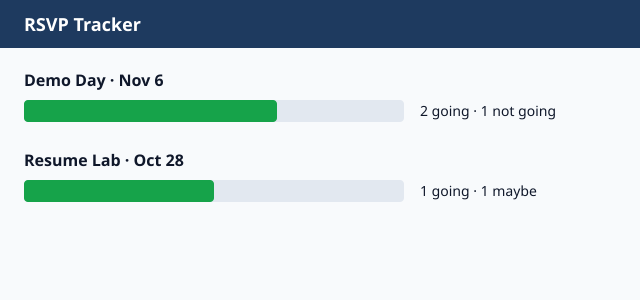

# RSVP Tracker

Track who's coming to cohort events at a glance, so staff can plan seats, food, and rooms without chasing replies.



## What it does

- Counts **yes / no / maybe** for every event
- Treats "Yes", "yes " and "YES" as the same answer
- Serves the summary as JSON for a dashboard to display

## Quickstart

Needs Node 18+. No install step.

```bash
git clone https://github.com/example-intern/rsvp-tracker.git
cd rsvp-tracker
npm test
npm start
```

Open http://localhost:3000/api/summary.

## Tech stack

Node.js (built-in `http`, `node:test`) · SQL (schema designed for SQLite/Postgres) · CSV sample data

## Project structure

```
src/        server + RSVP counting logic
tests/      automated tests (npm test)
sql/        schema.sql → seed.sql → queries.sql
data/       small made-up sample data
docs/       decisions and screenshots
```

## Data and SQL

Run in order: `sql/schema.sql`, `sql/seed.sql`, then `sql/queries.sql` for the headcount report. All data is made up.

## Decisions

Why one RSVP per person per event, and why the demo reads CSV: see [docs/DECISIONS.md](docs/DECISIONS.md).

## My role and what I learned

Built solo in Week 9 of i.c.stars. Hardest part: deciding how to handle people who change their answer. A database constraint solved it better than code did.

## What's next

A web page that shows the bars in the screenshot, and RSVPs that close when the event starts.

## License

MIT, see [LICENSE](LICENSE).
