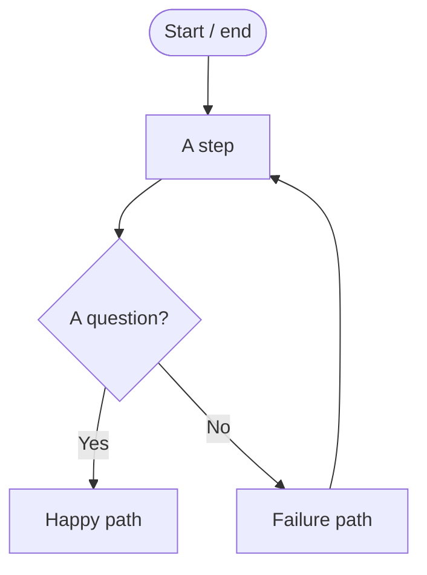

# T7B: From Stories to Design

**i.c.stars Tech Foundations · Week 7**

> Design is how we prevent chaos. It makes the invisible visible.

Last session you wrote functions and fixed bugs. Today you go one step *earlier*: before anyone writes code, how does a team figure out **what** to build? You'll turn a user story into diagrams and a **data contract**, the same contracts you'll turn into working API endpoints in **Week 9**.

**Standards:** DS.KU1 · DS.SK1 · DS.SK2 · DS.SK3 · DS.O1

---

## The traceability chain

Every line of code should trace back to something a user needs:

```
User Story → Workflow → Components → Interfaces → Contracts → Code
 who/what/why  steps+order  system parts  where parts talk  exact data  (Week 9)
```

## Setup (2 minutes)

- Open this folder in VS Code. Node 18+ is all you need. No `npm install`.
- For diagrams, open **https://mermaid.live** in your browser. You type text on the left and see the diagram on the right. No account needed.
- Optional: install the VS Code extension **Markdown Preview Mermaid Support** to see diagrams in the Markdown preview (`Ctrl+Shift+V`). GitHub shows Mermaid diagrams automatically.

## What's in here

| Path | What it's for | When |
|---|---|---|
| `examples/login/` | The worked example your trainer builds live. Your model. | Concept + Modeling |
| `stories/STORY_CARDS.md` | The four user stories (your team gets one) | Guided Practice |
| `my-design/DESIGN.md` | **Your main work.** Fill in every section. | Guided Practice |
| `my-design/contract/` | Your data contract + example data | Guided Practice |
| `my-design/PEER_REVIEW.md` | Feedback from the team you swap with | Application |

## Commands

| Command | Does |
|---|---|
| `npm run validate` | Tests your contract against your example data |
| `npm run check` | Shows which parts of your artifact are done |
| `npm run validate:example` | Runs the checker on the login example so you can see what "passing" looks like |

---

## Guided Practice (your team, 20 min)

Work in `my-design/`. Go in this order. Each step feeds the next.

1. **Story (2 min).** Copy your card's story into section 1.
2. **Checklist (3 min).** Fill in Inputs → Process → Outputs → Interfaces → Contracts. Use the acceptance criteria.
3. **Workflow (5 min).** Sketch on paper first, then build it in mermaid.live. Include **who** does each step and **at least one failure path**.
4. **Components (5 min).** At least 3–4 parts (e.g. a page, an API, a service, a database). Connect them. Label the frontend → backend arrow with your contract name.
5. **Contract (5 min).** Pick ONE interface. Write its contract in `contract/`. Start with shorthand, then upgrade to JSON Schema if you have time.
6. **Trace it.** Fill in section 7: story phrase → workflow step → component → contract field.

## Mermaid in 60 seconds



```text
flowchart TD           top-to-bottom (use LR for left-to-right)
a([text])              rounded: start or end
b[text]                box: a step or a component
c{text}                diamond: a decision
db[(text)]             cylinder: a database
u((text))              circle: a person
a --> b                arrow
c -- Yes --> d         arrow with a label
subgraph Frontend      group parts together (close it with: end)
```

Avoid quotes, parentheses, and brackets *inside* your box text. They confuse Mermaid. Also don't name a box `end`, `click`, `style`, or `class`. Those are Mermaid keywords.

## Contracts: two levels

**Level 1: Shorthand.** Fast. Every field is required. Add `?` to make one optional.

```json
{
  "email": "string",
  "nickname": "string?",
  "tags": ["string"]
}
```

**Level 2: JSON Schema.** Precise. This is what professional teams use. See `examples/login/contract/login-request.schema.json`.

```json
{
  "title": "LoginRequest",
  "type": "object",
  "properties": {
    "email": { "type": "string", "format": "email" },
    "password": { "type": "string", "minLength": 8 }
  },
  "required": ["email", "password"],
  "additionalProperties": false
}
```

Types: `string`, `number`, `integer`, `boolean`, `object`, `array`, `null`.
Useful extras: `format` (`email`, `date`, `date-time`, `uri`), `enum` (a fixed list of allowed values), `minLength`, `maxLength`, `minimum`, `maximum`.

**Prove your contract works.** In `contract/examples/`:
- `<name>.valid.json` is data that **should** pass.
- `<name>.invalid.json` is data that **should** fail (a missing field, a wrong type, a bad value).

`npm run validate` checks both. If your contract lets bad data through, it isn't strict enough yet.

## Application (swap, 10 min)

Swap with a team that has a **different** story. The other team explains *your* design back to you:

- Which part of the story connects to which system part?
- Does the interface and contract make sense? Could someone build it from your contract alone?

Write what they said in `my-design/PEER_REVIEW.md`. If they got stuck, that's where your design needs to be clearer.

## Before you leave

```bash
npm run check
```

Your **artifact** is:
- [ ] A workflow diagram (or context diagram)
- [ ] A component diagram showing the key system parts
- [ ] A JSON Schema (or OpenAPI snippet) for one interface, with example data that passes `npm run validate`

## How it's assessed

| Level | What the artifact shows |
|---|---|
| Limited | User story repeated but no diagram. No clear link to system parts. No schema. |
| Emerging | Workflow incomplete or unclear. Component diagram missing connections. Schema vague or inconsistent. |
| Developing | Workflow + component diagrams mostly accurate. Schema present but basic. Some traceability. |
| **Proficient** | Clear workflow + component diagrams with correct connections. Schema accurate with defined fields. Strong traceability from story to design. |
| Advanced | Polished diagrams. Detailed, extensible schema or OpenAPI snippet. Design is ready for coding. |

Limited or Emerging? You'll join a 30-minute design clinic this week with a simpler story. That's practice, not punishment.

---

**Rule of thumb: if you can explain it in a diagram, you can explain it in code.**
