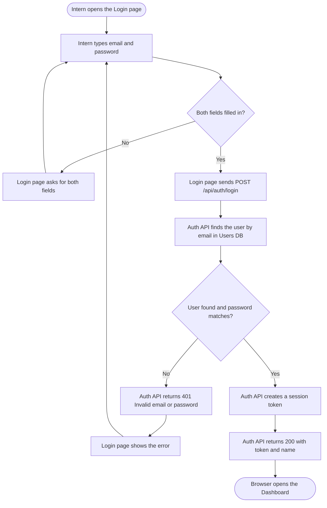
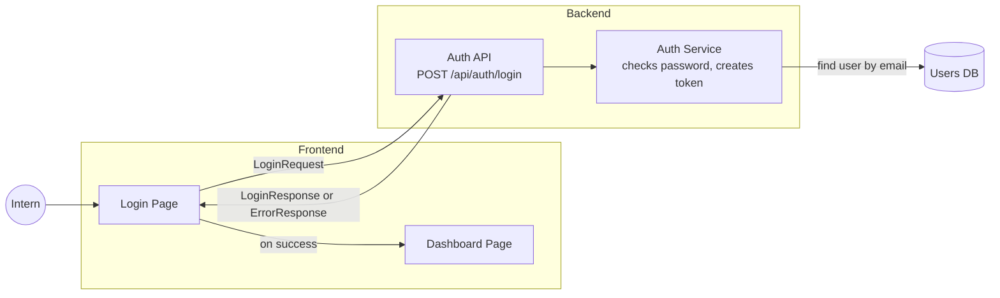

# Design: Log In to CohortHub

> **This is the worked example your trainer builds live.** Use it as a model for your own design in `my-design/`. Notice how every part points back to the user story.

**Team:** Trainer demo
**Story card:** Example (Login)

## 1. User Story

> As a returning intern, I want to log in with my email and password, so that I can see my CohortHub dashboard.

## 2. Design Checklist

- **Inputs:** email, password (typed by the intern on the Login page)
- **Process:** check both fields are filled in, send them to the Auth API, find the user by email, compare the password, create a session token
- **Outputs (success):** a session token and the intern's name; the browser opens the Dashboard
- **Outputs (failure):** a 401 error with the message "Invalid email or password"; the intern stays on the Login page
- **Interfaces:** Login Page → Auth API (`POST /api/auth/login`); Auth Service → Users DB (find user by email)
- **Contracts:** `LoginRequest`, `LoginResponse`, `ErrorResponse` (see `contract/`)

## 3. Workflow Diagram

Who does what, in what order. The failure path matters as much as the happy path.

## 4. Component Diagram

The parts of the system, and which parts talk to each other. Arrow labels name the contract.

## 5. Interfaces

| # | From → To | Method + Path (or name) | Request contract | Response contract |
|---|---|---|---|---|
| 1 | Login Page → Auth API | `POST /api/auth/login` | `login-request.schema.json` | `login-response.schema.json` (200), `error-response.schema.json` (400/401) |
| 2 | Auth Service → Users DB | find user by email | email | user row (id, name, email, password hash) |

## 6. Contract

See `contract/`. Run `npm run validate:example` to test it against the examples.

- `login-request.schema.json`: what the Login page sends
- `login-response.schema.json`: what comes back on success
- `error-response.schema.json`: what comes back on failure
- `../login.openapi.yaml`: the same interface written as OpenAPI (the Week 9 format)

## 7. Traceability

Every phrase in the story should land somewhere in the design.

| Story phrase | Workflow step | Component | Contract field |
|---|---|---|---|
| "a returning intern" | Intern opens the Login page | Users DB (the account already exists) | `user.id` |
| "with my email" | Intern types email and password | Login Page | `email` |
| "and password" | Auth API finds the user and compares the password | Auth Service | `password` |
| "log in" | Auth API creates a session token | Auth Service | `token` |
| "see my CohortHub dashboard" | Browser opens the Dashboard | Dashboard Page | `user.name` |
