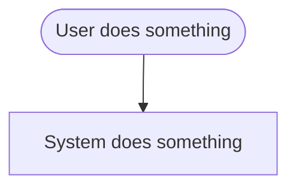
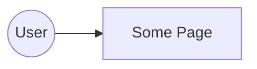

# Design: ___

**Team:** 
**Story card:** 

## 1. User Story

Copy your story from `stories/STORY_CARDS.md`. Keep the format.

> As a ___, I want ___, so that ___.

## 2. Design Checklist

Fill these in BEFORE you draw. Short phrases are fine.

- **Inputs:** 
- **Process:** 
- **Outputs (success):** 
- **Outputs (failure):** 
- **Interfaces:** 
- **Contracts:** 

## 3. Workflow Diagram

Who does what, in what order? Start with the user. End with what they get. Include at least one failure path.

Tip: sketch it on paper first. Then build it at https://mermaid.live and paste the code here.

## 4. Component Diagram

What are the parts of the system (at least 3-4), and which parts talk to each other? Label the arrows between frontend and backend with your contract name.

## 5. Interfaces

One row for every place where two parts talk. You need at least one.

| # | From → To | Method + Path (or name) | Request contract | Response contract |
|---|---|---|---|---|
| 1 |  |  |  |  |

## 6. Contract

Write the contract for ONE interface in `contract/`:

1. Rename `contract/RENAME-ME.schema.json` to match your interface (e.g. `reset-request.schema.json`).
2. Rename the example files in `contract/examples/` to match (`reset-request.valid.json`, `reset-request.invalid.json`).
3. Run `npm run validate` until everything passes.

## 7. Traceability

Pick phrases straight out of your story. Show where each one lives in your design. Aim for 3+ rows.

| Story phrase | Workflow step | Component | Contract field |
|---|---|---|---|
|  |  |  |  |
|  |  |  |  |
|  |  |  |  |
